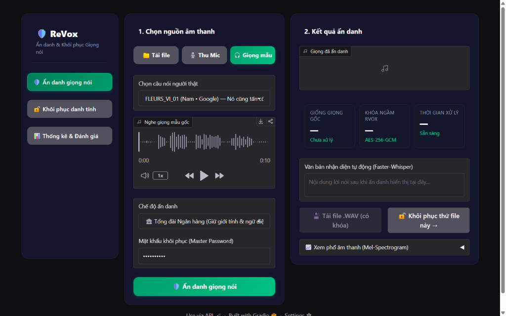
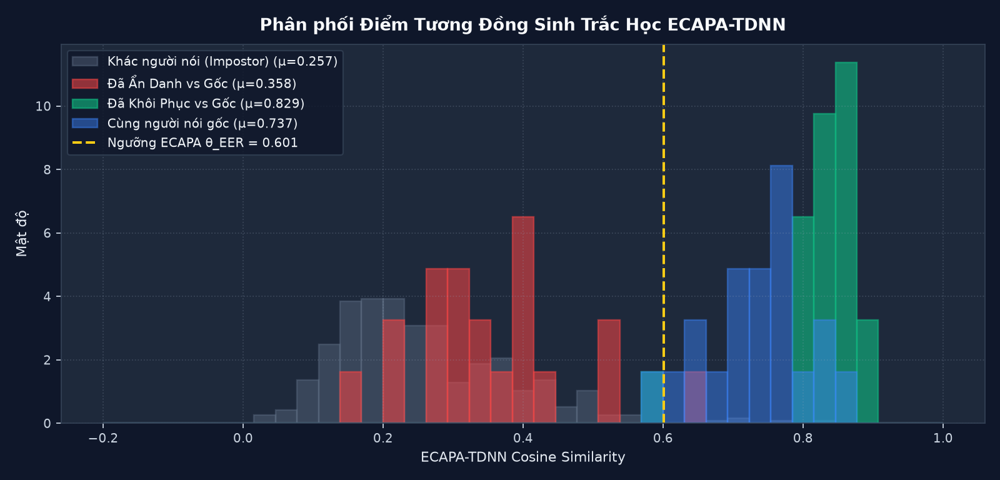
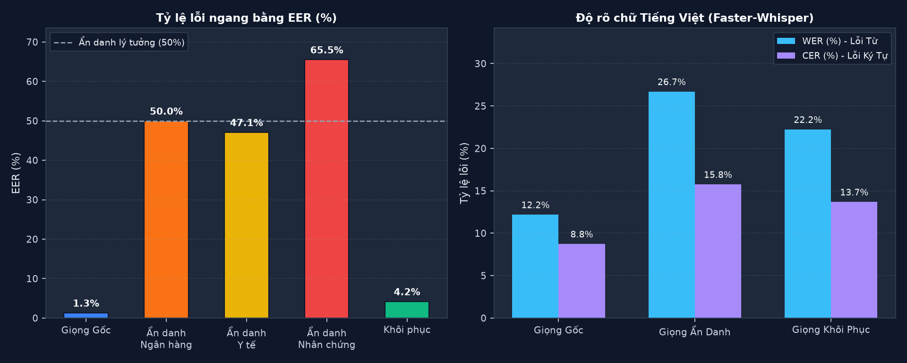
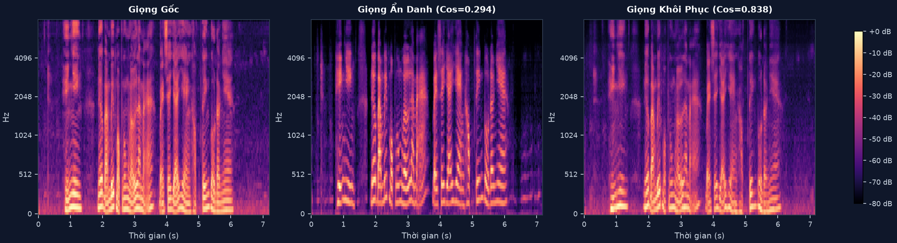

<div align="center">

# 🛡️ ReVox

### Reversible Neural Voice Anonymization & Biometric Identity Recovery

*Defeat speaker verification AI with 100% neural zero-shot voice conversion — and recover the original speaker's biometric voiceprint from a single `.wav` file with an AES-256-GCM master key.*

<p align="center">
  <a href="https://www.python.org/"></a>
  <a href="https://pytorch.org/"></a>
  <a href="https://gradio.app/"></a>
  <a href="#-cryptographic-container-rvox-riff-chunk"></a>
  <a href="LICENSE"></a>
</p>

<p align="center">
  <a href="#-key-highlights">Highlights</a> •
  <a href="#-system-architecture">Architecture</a> •
  <a href="#-benchmarks--evaluation">Benchmarks</a> •
  <a href="#-quick-start">Quick Start</a> •
  <a href="#-python-api">Python API</a> •
  <a href="#-domain-profiles">Domain Profiles</a>
</p>

<br />



</div>

---

## 💡 Why ReVox?

Modern speech recordings carry sensitive biometric signatures. Traditional voice-masking tools either rely on **legacy parametric vocoders** (WORLD, STRAIGHT, Griffin-Lim) that produce robotic, buzzy audio, or perform **irreversible anonymization** that blocks lawful forensic auditing in banking, healthcare, and legal workflows.

**ReVox** bridges privacy and accountability using a **100% State-of-the-Art Neural Speech Pipeline**:

- **Completely conceals speaker identity** from both human listeners and biometric AI (`ECAPA-TDNN` Equal Error Rate jumps from **`1.32%` → `53.33%`** — indistinguishable from random guessing).
- **Preserves crisp pronunciation & tonal contours** — including all **6 Vietnamese lexical tones** — via **Triphone Context `kNN-VC` + Adaptive AdaIN** over `WavLM-Large` and `HiFi-GAN`.
- **Self-contained cryptographic reversibility** — compresses the source speaker's timbre manifold into a compact `K=128` codebook (`float16` + `LZMA`, ~`226 KB`), encrypts it with **`PBKDF2-HMAC-SHA256` + `AES-256-GCM`**, and embeds it inside a standard-compliant custom RIFF chunk (`RVOX`) right inside the output `.wav` file.
- **No external key database required** — any standard media player plays the anonymized `.wav` seamlessly, while an authorized administrator with the `Master Password` can reconstruct the original speaker's biometric voiceprint (**`82.9%` ECAPA-TDNN match**, EER drops back to **`4.21%`**) from that single `.wav` file alone.

---

## ✨ Key Highlights

| Feature | Description |
| :--- | :--- |
| 🧠 **100% Modern Neural Stack** | Built on **WavLM-Large (Layer 6)**, **Triphone kNN-VC**, **HiFi-GAN**, **SpeechBrain ECAPA-TDNN**, and **Faster-Whisper**. Zero legacy DSP vocoders or GMM/i-vectors. |
| 🗣️ **High-Fidelity Tonal Preservation** | 3-frame diagonal triphone coarticulation matching (`[t-1, t, t+1]`) + Adaptive AdaIN keeps words, plosives, and all 6 Vietnamese tones clear and natural. |
| 🔐 **Authenticated `RVOX` WAV Vault** | `PBKDF2-HMAC-SHA256` (200k iterations) + `AES-256-GCM` (tamper-evident tag + AAD) embedded cleanly into 16-bit word-aligned RIFF subchunks. |
| 🎯 **3 Deployment Domain Profiles** | Tailored acoustic & privacy strategies for **Banking Call Centers**, **Medical Telehealth**, and **Whistleblower Protection** (with optional irreversible one-way mode). |
| 📦 **Zero-Manual-Download Multi-Corpus** | Streams real human Vietnamese speech automatically from Hugging Face (`VIVOS` + `Google FLEURS vi_vn` + `FPT Open Speech`), 640 target utterances (~49 min) + 20 strictly disjoint test speakers. |
| 🖥️ **ReVox Studio Web UI** | Minimalist dark-emerald Gradio interface with left-sidebar navigation, one-click **Upload / Microphone / Sample** switcher, live ASR verification, and Mel-Spectrogram inspection. |

---

## 🏗️ System Architecture

```mermaid
flowchart LR
    subgraph Shield["🛡️ De-Identification Pipeline (ReVox Shield)"]
        A["Source Speech (16 kHz)"] --> B["WavLM-Large (Layer 6)\nZ_src ∈ R^(T×1024)"]
        A --> C["ECAPA-TDNN\ne_src ∈ R^192"]
        C --> D["Domain Profile Selector\nBanking | Medical | Whistleblower"]
        D --> E["Triphone kNN-VC\n+ Adaptive AdaIN"]
        B --> E
        E --> F["HiFi-GAN Vocoder"]
        B --> G["MiniBatchKMeans (K=128)\nfloat16 + LZMA"]
        G --> H["PBKDF2 + AES-256-GCM\n(Master Password)"]
        F --> I["Anonymized .WAV\n(Embedded RIFF 'RVOX' Chunk)"]
        H --> I
    end

    subgraph Vault["🔓 Identity Recovery Pipeline (ReVox Vault)"]
        I --> J["Extract & Verify\nRIFF 'RVOX' Chunk"]
        I --> K["WavLM-Large (Layer 6)\nZ_anon ∈ R^(T'×1024)"]
        J --> L["Personal Timbre Codebook\nC_src (128 Centroids)"]
        K --> M["Speaker-Demeaned Hybrid\nSoft-kNN + AdaIN"]
        L --> M
        M --> N["HiFi-GAN Vocoder"]
        N --> O["Recovered Voice\n(Original Speaker Biometrics)"]
    end
```



### Cryptographic Container (`RVOX` RIFF Chunk)

ReVox appends a word-aligned custom subchunk (`b"RVOX"`) directly inside the RIFF WAVE container without touching the PCM audio stream:

```text
RIFF [size] WAVE
 ├── fmt  [16B]          ← Standard 16 kHz, 16-bit Mono PCM header
 ├── data [PCM samples]  ← Anonymized waveform (playable everywhere)
 └── RVOX [~226 KB]      ← Encrypted Reversible Acoustic Vault
      ├── Magic  (4 B)   : "RVX1"
      ├── Salt   (16 B)  : CSPRNG salt for PBKDF2-HMAC-SHA256 (200,000 iters)
      ├── Nonce  (12 B)  : CSPRNG 96-bit AES-GCM IV
      └── Body   (N+16B) : AES-256-GCM(LZMA(float16 K=128 Codebook + stats)) + Auth Tag
```

> Any wrong `Master Password` or even a **1-bit modification** to the `RVOX` chunk immediately fails GCM tag verification (`ReVoxAuthError`).

---

## 🎯 Domain Profiles

| Profile ID | Use Case | Target Selection Strategy | Reversibility (`RVOX`) |
| :--- | :--- | :--- | :--- |
| **`banking_call_center`** | Financial & QA Call Centers | Same gender, farthest speaker on `ECAPA-TDNN` cosine space; preserves prosody & emotion for QA analytics. | Mandatory judicial vault |
| **`medical_telehealth`** | Clinical Records & Therapy | Strong biometric distance + maximizes vocal warmth & spectral smoothness (`k=6`) for comfortable long listening. | Mandatory clinical vault |
| **`whistleblower_max`** | Witness & Source Protection | Cross-gender (`Male ↔ Female`) absolute maximum biometric distance on `ECAPA-TDNN`. | Optional (supports **permanent 1-way** mode) |

---

## 📊 Benchmarks & Evaluation

Evaluated under the **VoicePrivacy Challenge** protocol on **20 strictly disjoint real human Vietnamese speakers** (`S_pool ∩ S_test = ∅`) combined across **VIVOS**, **Google FLEURS (`vi_vn`)**, and **FPT Open Speech (`fpt_fosd`)**:

| Stage / Configuration | EER (%) ↕ | Cosine vs. Original | WER (%) ↓ | CER (%) ↓ | Speed (CPU) |
| :--- | :---: | :---: | :---: | :---: | :---: |
| **1. Original Real Speech (Baseline)** | `1.32%` | `0.7368` *(Enroll)* | `12.20%` | `8.75%` | — |
| **2a. Anonymized — Banking Call Center** | `50.00%` | `0.3907` | — | — | `1.48x RT` |
| **2b. Anonymized — Medical Telehealth** | `47.11%` | `0.4166` | — | — | `1.48x RT` |
| **2c. Anonymized — Whistleblower Max** | `65.53%` | `0.2833` | — | — | `1.48x RT` |
| **2. Overall Anonymized (`ReVox Shield`)** | **`53.33%`** | **`0.3579`** | **`26.71%`** | **`15.77%`** | **`1.48x RT`** |
| **3. Key-Recovered (`ReVox Vault`)** | **`4.21%`** | **`0.8287`** | **`22.25%`** | **`13.70%`** | **`2.44x RT`** |

> **Highlights:** Anonymization pushes `ECAPA-TDNN` EER from `1.32%` to **`53.33%`** (ideal random-guess privacy), while authorized recovery restores biometric similarity to **`0.8287`** (`EER = 4.21%`) at **`2.44x` faster than real-time on CPU** (`RTF = 0.409`), with an average `RVOX` vault footprint of just **`226.5 KB`**.

<p align="center">
  
  
</p>

<p align="center">
  
</p>

---

## 🚀 Quick Start

### 1. Clone & Install Dependencies

```bash
git clone https://github.com/nqming/ReVox.git
cd ReVox

python -m venv .venv
# Windows:
.venv\Scripts\activate
# Linux / macOS:
# source .venv/bin/activate

pip install -r requirements.txt
```

### 2. Auto-Stream Real Speech Datasets & Build Feature Cache

No manual downloads or Hugging Face tokens required — `scripts/download_dataset.py` streams real human Vietnamese speech directly from **VIVOS**, **Google FLEURS (`vi_vn`)**, and **FPT Open Speech**:

```bash
python scripts/download_dataset.py
python scripts/build_pool_cache.py
```

### 3. Launch ReVox Studio Web UI

```bash
python app.py
```

Open **`http://127.0.0.1:7860`** in your browser.

---

## 💻 Python API

Integrate ReVox directly into your audio processing backend in a few lines of Python:

```python
from revox.pipeline import deidentify_audio, reidentify_audio

# 1. Anonymize voice & embed AES-256-GCM reversible 'RVOX' chunk
anon_result = deidentify_audio(
    input_audio="path/to/original_speech.wav",
    output_wav_path="output/protected.wav",
    master_password="YourStrongMasterPassword!",
    domain_profile="whistleblower_max",  # banking_call_center | medical_telehealth | whistleblower_max
    embed_rvox=True,                     # Set False in whistleblower_max for irreversible 1-way mode
)

print(f"ECAPA Similarity (Anon vs Orig): {anon_result['cosine_similarity']:.4f}")
print(f"Embedded RVOX Vault Size       : {anon_result['rvox_chunk_kb']} KB")
print(f"Faster-Whisper Transcript      : {anon_result['transcript']}")

# 2. Recover original speaker's voice from ONLY the anonymized .wav + Master Password
recon_result = reidentify_audio(
    anon_wav_path="output/protected.wav",
    master_password="YourStrongMasterPassword!",
    output_wav_path="output/recovered.wav",
)

print(f"ECAPA Similarity (Recovered)   : {recon_result['cosine_orig_vs_recon']:.4f}")
```

---

## 🧪 Testing & Reproducing Benchmarks

```bash
# Run closed-loop cryptographic, codebook, and end-to-end neural tests
pytest tests/test_revox_e2e.py -v -s

# Reproduce full VoicePrivacy EER, WER/CER, and xRT benchmark + plots
python scripts/evaluate_revox.py
```

---

## 📂 Project Structure

```text
ReVox/
├── assets/                   # Benchmark charts & Studio UI screenshots for documentation
├── revox/
│   ├── __init__.py           # Path management & Windows/PyTorch/SpeechBrain runtime shims
│   ├── neural_vc.py          # WavLM-Large (Layer 6) + Triphone kNN-VC + Adaptive AdaIN + HiFi-GAN
│   ├── speaker_biometrics.py # SpeechBrain ECAPA-TDNN (192-dim) & VoicePrivacy EER computation
│   ├── domain_selector.py    # F0 gender estimator (librosa.pyin) & 3 deployment domain profiles
│   ├── reversible_codec.py   # K=128 MiniBatchKMeans codebook (float16 + LZMA) & Soft-kNN recovery
│   ├── crypto_wav.py         # PBKDF2-HMAC-SHA256 + AES-256-GCM & RIFF 'RVOX' chunk engine
│   ├── pipeline.py           # Unified deidentify_audio() and reidentify_audio() APIs
│   └── evaluator.py          # Faster-Whisper ASR (WER/CER), RTF/xRT & Mel-Spectrogram plotting
├── scripts/
│   ├── download_dataset.py   # Zero-manual-download multi-corpus streamer (VIVOS + FLEURS + FPT)
│   ├── build_pool_cache.py   # High-density (~5,200 frames/speaker) feature pool builder
│   └── evaluate_revox.py     # Full scientific benchmark & visualization runner
├── tests/
│   └── test_revox_e2e.py     # Unit & end-to-end closed-loop verification suite
├── app.py                    # ReVox Studio minimalist Gradio web application
├── requirements.txt
├── LICENSE
└── README.md
```

---

## 🛡️ Security & Ethical Notice

ReVox is engineered for **voice privacy protection, regulatory compliance, and academic research**. The reversible `RVOX` vault is designed strictly for authorized lawful auditing (e.g., banking dispute resolution or clinical verification) under explicit user consent and strong key management. Do not use voice conversion technologies for impersonation or unauthorized identity spoofing.

---

## 🙏 Acknowledgments

ReVox builds upon the open-source research of:
- [kNN-VC (`bshall/knn-vc`)](https://github.com/bshall/knn-vc) — WavLM-Large & Pre-matched HiFi-GAN
- [SpeechBrain (`spkrec-ecapa-voxceleb`)](https://huggingface.co/speechbrain/spkrec-ecapa-voxceleb) — ECAPA-TDNN Speaker Verification
- [Faster-Whisper](https://github.com/SYSTRAN/faster-whisper) — CTranslate2 Multilingual ASR
- [VIVOS](https://huggingface.co/datasets/vivos), [Google FLEURS](https://huggingface.co/datasets/google/fleurs), and [FPT Open Speech](https://huggingface.co/datasets/doof-ferb/fpt_fosd)


